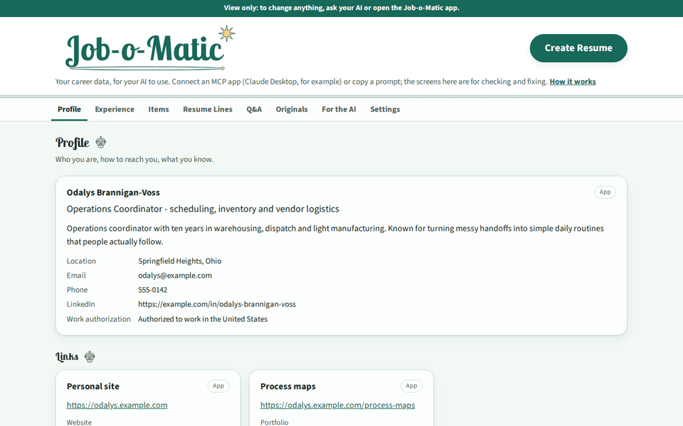
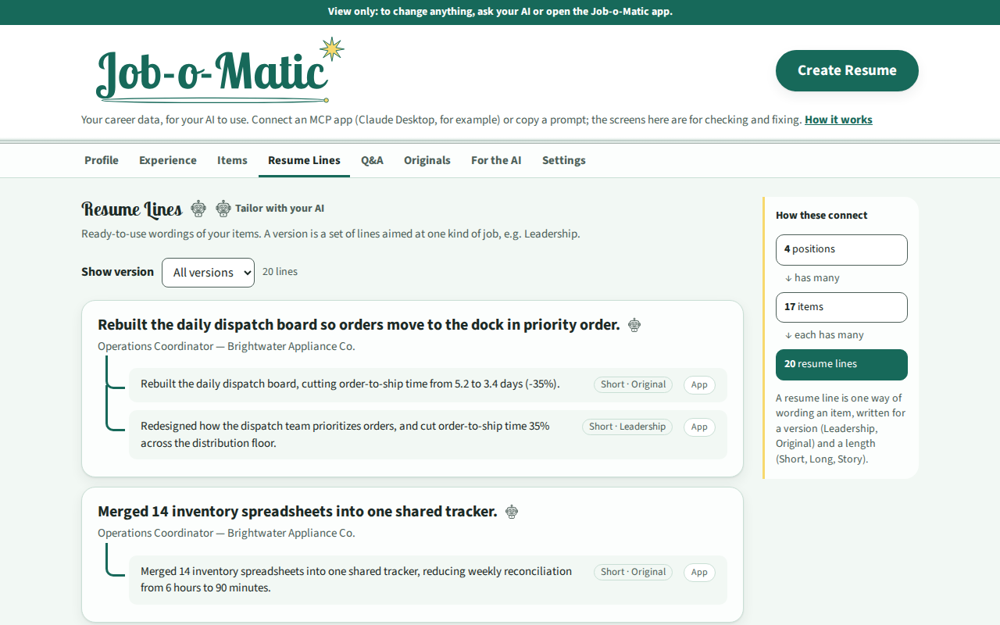
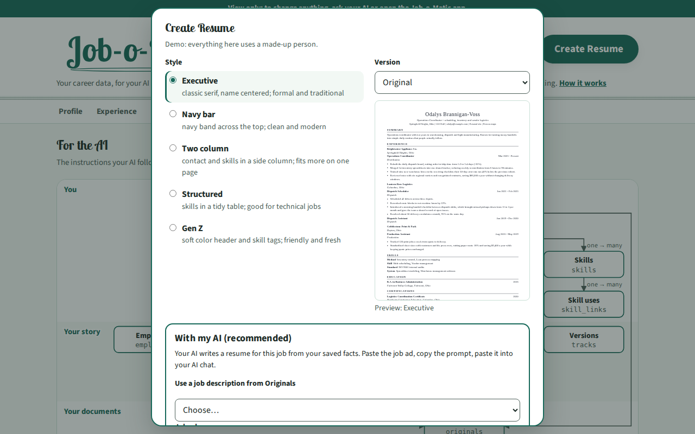
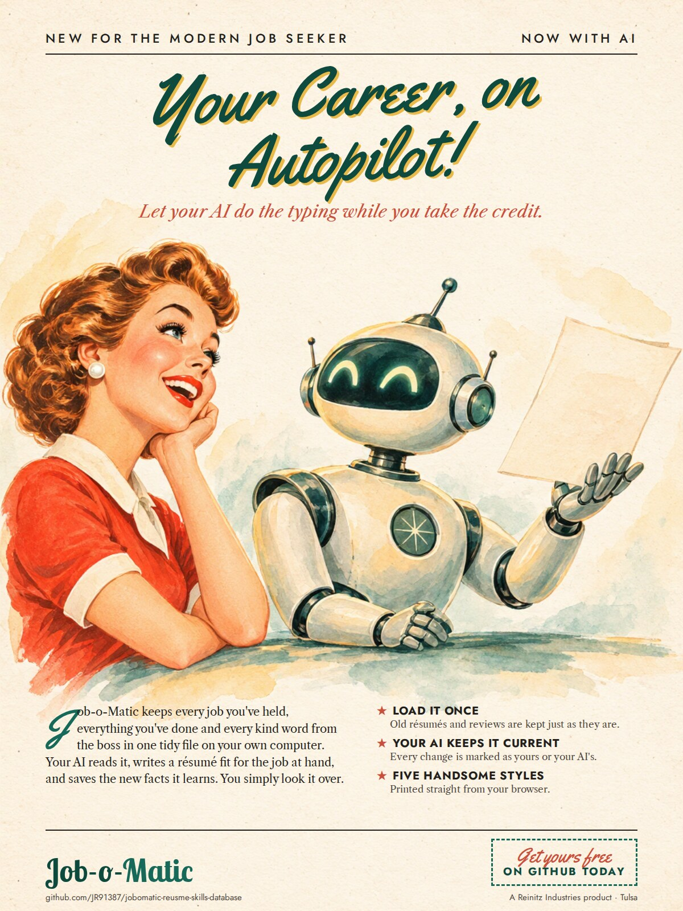

# A career database your AI uses to write your resumes, fast.

*The labor-saving way to keep your career facts. Now with AI.*

Load your work history once. From then on your AI keeps it up to date and pulls from it whenever you need a resume, a cover letter or an interview answer. You don't retype anything.

**Runs on your computer · No account · Works with any MCP app or chat AI · Windows, Mac, Linux**

| You | Your AI | Your AI |
|---|---|---|
| **Seed it once.** Drop in old resumes, reviews and job posts, or type the basics. Your files are kept unedited. | **Keeps it current.** Turns your files into facts, writes resume lines and saves new facts as it learns them. | **Writes from it.** Tailored resumes in five styles, cover letters and interview answers, from facts you've checked. |



*The screens are for checking and fixing. Most changes come from your AI, and each one is marked **You** or **AI**. Shown with the made-up demo data that ships with the app.*

## Documentation
The [wiki](../../wiki) explains the database and how to use it. It's written mainly for AIs; a copy lives in [`docs/wiki/`](docs/wiki) for agents working from a clone.

- **If you are an AI:** start at [Quick Start for AI](../../wiki/Quick-Start-for-AI), then [Data Model](../../wiki/Data-Model), [Table Reference](../../wiki/Table-Reference) and [MCP Tools](../../wiki/MCP-Tools).
- **If you are a person:** [Install and First Run](../../wiki/Install-and-First-Run) and [Your Data and Privacy](../../wiki/Your-Data-and-Privacy).

## How your data flows
Everything lives in one file on your computer. You put facts in. Your AI reads them, saves what it finds and writes from them.


Yellow is what you do; green is what your AI does. An employer can have several positions, so a promotion stays under one company. An item is one thing you did. A resume line is one way of wording it, short or long, for a given kind of job.

## Who does what
| Who | Does |
|---|---|
| **You** | Add the starting facts: old resumes, performance reviews, job posts you liked. Read what your AI saved and fix anything wrong. |
| **Your AI** | Reads your files, turns them into employers, positions and items, writes resume lines, answers interview questions with you, and saves new facts back. |
| **Job-o-Matic** | Keeps it all in one place, records who changed what, backs it up daily and prints resumes in five styles (executive, navy bar, two column, structured, genz). |





## Get yours
Pick the one for your computer. Each link opens the newest release; the file you want is named below.

- [Download for Windows](../../releases/latest): `Job-o-Matic_v<version>_windows-x64.zip`
- [Download for Mac (Apple chip)](../../releases/latest): `Job-o-Matic_v<version>_macos-arm64.zip`
- [Download for Mac (Intel)](../../releases/latest): `Job-o-Matic_v<version>_macos-x64.zip`
- [Download for Linux](../../releases/latest): `Job-o-Matic_v<version>_linux-x64.zip`

Which Mac do I have? Click the Apple menu, then **About This Mac**. If it says "Apple M1" (or M2, M3...), choose Apple chip. If it says "Intel", choose Intel.

## Connect your AI
1. **Best: an MCP app.** Any app that speaks MCP (Model Context Protocol) can read and save your data directly: run `app/src/jobomatic/mcp_server.py` with the bundled Python and your data file (`my_data/jobomatic.db`) as its argument. See [MCP Tools](../../wiki/MCP-Tools). For Claude Desktop there is a one-step connector: run it once, then fully quit Claude Desktop (Cmd+Q on Mac) and reopen it.
   ```
   # Windows
   python\python.exe app\scripts\connect_claude_desktop.py --write
   # Mac / Linux
   python/bin/python3 app/scripts/connect_claude_desktop.py --write
   ```
   Run it without `--write` to preview; nothing is changed. Your other Claude Desktop settings are kept, and a backup is made first.
2. **AIs that run commands** (Claude Code, Codex and similar): point them at `app/docs/AI_GUIDE.md`. They can also use the database from the command line with `src/db.py`.
3. **Any chat AI:** click the robot button on a section or **Create Resume**, copy the prompt, paste it into your AI, and paste its answer back.

Then ask something like: *"Read my old resume in Job-o-Matic's originals and fill in my experience."*

## Open it
Unzip the download anywhere, for example your Documents folder. Python comes inside; there is nothing to install. The app is free and not paid-for "signed", so your computer will warn you once. This is expected, and nothing is sent anywhere.

<details>
<summary>Windows</summary>

Right-click the zip and choose **Extract All** (Windows marks files from the internet, and a zip opened without extracting can fail). Double-click `Job-o-Matic.bat`. If a blue box says **"Windows protected your PC"**, click **More info**, then **Run anyway**. A black window opens and stays open while the app runs. Closing it stops the app.
</details>

<details>
<summary>Mac</summary>

Double-click `Job-o-Matic.command`. A box says it can't be opened. Click **Done**. Then open **System Settings**, then **Privacy & Security**, scroll down to the Security heading, and click **Open Anyway** next to the Job-o-Matic message. Confirm with **Open** and your Mac password. (On macOS 14 and older you can instead right-click the file and choose **Open**.) You may see the same box once more for the bundled Python; do the same again. After that it opens normally. A Terminal window stays open while the app runs. Closing it stops the app.
</details>

<details>
<summary>Linux</summary>

In a terminal, run `chmod +x job-o-matic.sh` once, then `./job-o-matic.sh`.
</details>

Then a browser tab opens at `http://127.0.0.1:8765/app/`. The number is 8765 (or the next free number shown) in the window that stays open. That address is your own computer; nothing goes on the internet.

To just look around, double-click `Job-o-Matic (view only).html`. No program needs to be running.

## Your data
- Everything is in the `my_data` folder next to the app. Nothing is sent anywhere (see `PRIVACY.md`).
- A copy is saved each day in `my_data/backups/`; the last 30 are kept. To back up everything, copy the `my_data` folder.
- Every change is marked as made by **You** or your **AI**.

## For developers
```
src/db/            schema.sql (the rules live in SQL), seed_blank.sql, seed_demo.sql
src/jobomatic/     store, originals + extract, helper (local edit server), viewer,
                   mcp_server, resume, demo
src/web/           the screens (plain HTML/CSS/JS, sql.js, no build step)
src/db.py          command-line access
templates/         resume templates
scripts/           Claude Desktop connector, bundle builder
tests/             python -m unittest
docs/              AI_GUIDE.md, wiki/ (mirror of the GitHub wiki)
```
Tests: `python -m unittest` from this folder (needs `mcp` and `pypdf` installed).

## From the archives



## Licence
MIT. See `LICENSE`, and `NOTICE.md` for the third-party parts.
Copyright (c) 2026 Jerry Reinitz

Built by Jerry Reinitz at Reinitz Industries: bespoke, effective software, developed in Tulsa. https://jerryreinitz.com

<!-- First-run wording checked 2026-11-02:
macOS 15+ removed Control-click -> Open; use System Settings > Privacy & Security > Open Anyway (Apple developer news quoted at
  https://www.idownloadblog.com/2024/08/07/apple-macos-sequoia-gatekeeper-change-install-unsigned-apps-mac/ , 2024-08-07).
Windows SmartScreen "Windows protected your PC" > More info > Run anyway:
  https://learn.microsoft.com/en-us/answers/questions/5909311/windows-protected-your-pc-microsoft-smartscreen-bl
  https://www.techeia.com/blog/fix-smartscreen-unrecognized-app-windows-11
-->
