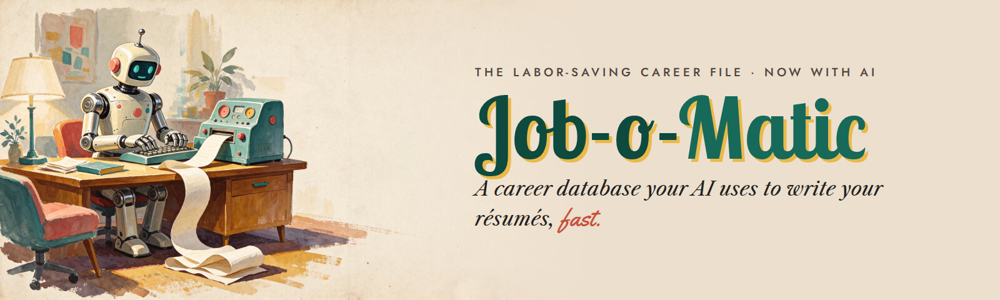

# A career database your AI uses to write your resumes, fast.

*The labor-saving way to keep your career facts. Now with AI.*

Load your work history once. From then on your AI keeps it up to date and pulls from it whenever you need a resume, a cover letter or an interview answer. You don't retype anything.

**Runs on your computer · No account · Works with any MCP app or chat AI · Windows, Mac, Linux**

| You | Your AI | Your AI |
|---|---|---|
| **Seed it once.** Drop in old resumes, reviews and job posts, or type the basics. Your files are kept unedited. | **Keeps it current.** Turns your files into facts, writes resume lines and saves new facts as it learns them. | **Writes from it.** Tailored resumes in five styles, cover letters and interview answers, from facts you've checked. |

*The screens are for checking and fixing. Most changes come from your AI, and each one is marked **You** or **AI**. Shown with the made-up demo data that ships with the app.*

## Documentation
The [wiki](https://github.com/JR91387/jobomatic-reusme-skills-database/wiki) explains the database and how to use it. It's written mainly for AIs; a copy lives in [`docs/wiki/`](docs/wiki) for agents working from a clone.

- **If you are an AI:** start at [Quick Start for AI](https://github.com/JR91387/jobomatic-reusme-skills-database/wiki/Quick-Start-for-AI), then [Data Model](https://github.com/JR91387/jobomatic-reusme-skills-database/wiki/Data-Model), [Table Reference](https://github.com/JR91387/jobomatic-reusme-skills-database/wiki/Table-Reference) and [MCP Tools](https://github.com/JR91387/jobomatic-reusme-skills-database/wiki/MCP-Tools).
- **If you are a person:** [Install and First Run](https://github.com/JR91387/jobomatic-reusme-skills-database/wiki/Install-and-First-Run) and [Your Data and Privacy](https://github.com/JR91387/jobomatic-reusme-skills-database/wiki/Your-Data-and-Privacy).
- **If you are a developer:** [For Developers](https://github.com/JR91387/jobomatic-reusme-skills-database/wiki/For-Developers).

## How your data flows
Everything lives in one file on your computer. You put facts in. Your AI reads them, saves what it finds and writes from them.

Yellow is what you do; green is what your AI does. An employer can have several positions, so a promotion stays under one company. An item is one thing you did; a resume line is one way of wording it. The full picture is in [Data Model](https://github.com/JR91387/jobomatic-reusme-skills-database/wiki/Data-Model).

## Get yours
Pick the one for your computer from the [newest release](../../releases/latest):

- Windows: `Job-o-Matic_v<version>_windows-x64.zip`
- Mac with an Apple chip (M1, M2, M3...): `Job-o-Matic_v<version>_macos-arm64.zip`
- Mac with Intel: `Job-o-Matic_v<version>_macos-x64.zip`
- Linux: `Job-o-Matic_v<version>_linux-x64.zip`

## Open it
Unzip it anywhere; Python comes inside. The app isn't paid-for "signed", so your computer warns you once:

- **Windows:** Extract All, double-click `Job-o-Matic.bat`, then **More info → Run anyway**.
- **Mac:** double-click `Job-o-Matic.command`, click **Done**, then **System Settings → Privacy & Security → Open Anyway**.
- **Linux:** `chmod +x job-o-matic.sh`, then `./job-o-matic.sh`.

A browser tab opens at `http://127.0.0.1:8765/app/`. The number is 8765 (or the next free number shown) in the window that stays open. That address is your own computer. Step-by-step help: [Install and First Run](https://github.com/JR91387/jobomatic-reusme-skills-database/wiki/Install-and-First-Run).

## Connect your AI
- **An MCP app** (Claude Desktop, for example) reads and saves your data directly. Quickest: `uvx job-o-matic-mcp` from PyPI, no download needed. The zip also has a one-step Claude Desktop connector; see [Install and First Run](https://github.com/JR91387/jobomatic-reusme-skills-database/wiki/Install-and-First-Run#5-connect-your-ai).
- **An AI that runs commands** (Claude Code, Codex and similar): point it at `app/docs/AI_GUIDE.md` or [Quick Start for AI](https://github.com/JR91387/jobomatic-reusme-skills-database/wiki/Quick-Start-for-AI).
- **Any chat AI:** click the robot button or **Create Resume**, copy the prompt, paste it into your AI, and paste its answer back.

Then ask something like: *"Read my old resume in Job-o-Matic's originals and fill in my experience."*

## Your data
Everything stays in the `my_data` folder next to the app, backed up daily. Nothing is sent anywhere. Details: [Your Data and Privacy](https://github.com/JR91387/jobomatic-reusme-skills-database/wiki/Your-Data-and-Privacy) and `PRIVACY.md`.

## Licence
MIT. See `LICENSE`, and `NOTICE.md` for the third-party parts.
Copyright (c) 2026 Jerry Reinitz

Built by Jerry Reinitz at Reinitz Industries: bespoke, effective software, developed in Tulsa. https://jerryreinitz.com

<!-- First-run wording checked 2026-11-02:
macOS 15+ removed Control-click -> Open; use System Settings > Privacy & Security > Open Anyway (Apple developer news quoted at
  https://www.idownloadblog.com/2024/08/07/apple-macos-sequoia-gatekeeper-change-install-unsigned-apps-mac/ , 2024-08-07).
Windows SmartScreen "Windows protected your PC" > More info > Run anyway:
  https://learn.microsoft.com/en-us/answers/questions/5909311/windows-protected-your-pc-microsoft-smartscreen-bl
  https://www.techeia.com/blog/fix-smartscreen-unrecognized-app-windows-11
-->
