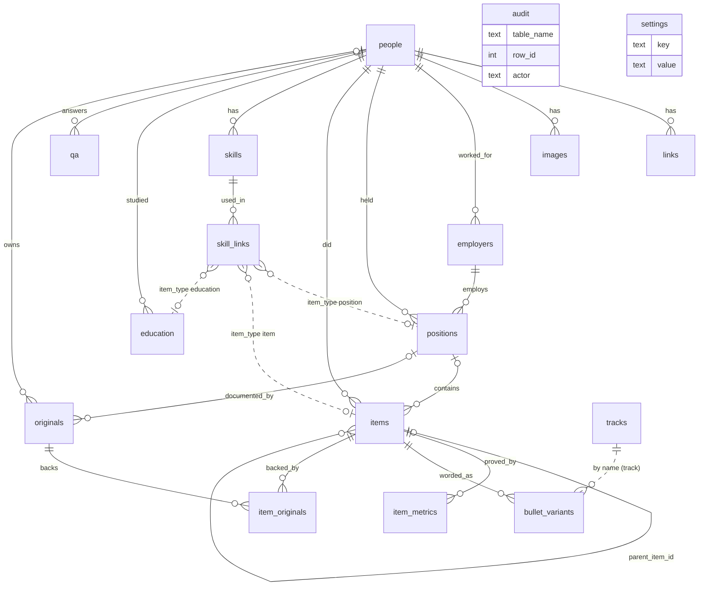

# Data Model

One SQLite file holds one person's career. Exact columns are in [[Table-Reference]]. Rules are in [[Rules-and-Invariants]].

## Diagram
Solid lines are real foreign keys in `src/db/schema.sql`. Notes below the diagram list the links that are not foreign keys.



Not foreign keys:
- `bullet_variants.track` holds a track name, not an id. Trigger `bullet_variants_track_ins` / `bullet_variants_track_upd` refuses a name that is not in `tracks.name`. Renaming a track rewrites its lines (`tracks_rename`).
- `skill_links.item_id` points into `positions`, `items` or `education` depending on `skill_links.item_type`. The database does not check it.
- `audit` points at any table by `table_name` + `row_id`. No FK.
- `settings` stands alone. Keys seeded: `recent_years`, `older_years`.
- `search_index` (FTS5) is derived data kept by `*_search_*` triggers. Do not write it.

Views: `experience` (positions + employer name, not Deprecated), `resume_lines` (lines + item), `resume_lines_ranked` (printable lines, ranked), `resume_json` (whole resume per track), `profile_json` (everything about the Active person), `last_change` (last actor per row). `schema_guide` is a table (read-only guide rows).

## The chain: employers, positions, items, resume lines
```
employers          who the person worked for
  positions        a title held there, start_date to end_date
    items          one fact each: something done or received
      item_metrics   the numbers that prove it (label, value, unit, as_of)
      bullet_variants  ready-made resume wording of the item (a "resume line")
```
- A **promotion is a second position** under the same employer. Demo example: employer "Lantern Row Logistics" has two positions, "Dispatch Assistant" (2019-06 to 2020-12) and "Dispatch Scheduler" (2021-01 to 2023-02).
- An **item** is one fact. `items.position_id` is optional: NULL means the fact is the person's own (an award, a publication). `items.parent_item_id` nests an item in another, for example an achievement inside a project. An item cannot sit inside itself, directly or through its parents (`items_parent_loop_ins`, `items_parent_loop_upd`, and `CHECK (parent_item_id IS NOT id)`).
- A **resume line** is a row in `bullet_variants`: `wording`, `length` (`Short`, `Long`, `Story`, or NULL), `angle`, and `track` (the version it is written for). One item can have many lines. `Story` lines are paragraphs for cover letters and interviews. They are never printed as resume bullets.
- **Metrics** are text, quoted as on a resume (`"30%"`, `"$1.2M"`). They are not computed.
- An item with no printable line for a track shows up under `items_without_lines` in `resume_data` for that position. Write a line for it, or leave it.

Write order: `items`, then `item_metrics`, then `bullet_variants`.

### Item types
`items.kind` must be one of: `Project`, `Responsibility`, `Achievement`, `Award`, `Publication`, `Volunteer`, `Speaking`, `Recommendation`, `Review`, `Kudos`. An item needs a `title` or a `detail` (`CHECK (title IS NOT NULL OR detail IS NOT NULL)`, and trigger `items_text_ins` rejects both blank).

`resume_data` puts `Responsibility` and `Achievement` items under their position (through their lines). Every other kind goes into the top-level `items` array. `build_resume` prints `Award` and `Project` from that array.

Other kind lists: `links.kind` = `LinkedIn`, `GitHub`, `Website`, `Portfolio`, `Other`. `education.kind` = `Degree`, `Course`, `Certification`, `Training`, `Self-study`. `skills.category` = `Skill`, `System`, `Method`, `Standard`. `originals.kind` = `Resume`, `Job description`, `Review`, `Recommendation`, `Other`, `AI output`.

## Originals and how facts link back
`originals` is an index of the person's unedited files (past resumes, job descriptions, reviews, recommendations). The file lives in `my_data/originals/<kind folder>/`. Its extracted text sits next to it as `<path>.txt`. `originals.sha256` detects edits and duplicates. `originals.weight` is trust: 3 official, 2 the person's own, 1 loose notes. `originals.position_id` optionally ties a document to a job.

To link a fact back to its document, insert a row in **`item_originals`** (`item_id`, `original_id`, optional `note`). It is many-to-many. There is no `original_id` column on `items`. `profile_json` and `get_profile` return each item's `original_ids`. See [[Filling-From-Documents]].

## Authorship: You and AI
Every write carries an author in `updated_by`: `user` (the person, in the app), `ai` (you), or `app` (the program itself, for example seeding). The after-write trigger copies it into `audit` as `actor`, stamps `updated_at`, then clears `updated_by` to NULL. So `updated_by` is always empty when you read a row. To find who wrote a row:
- MCP `get(table, id)` returns `created_by` and `last_changed_by`.
- SQL: `SELECT * FROM last_change WHERE table_name='items' AND row_id=5` or read `audit`.

The app shows each change as **You** or **AI**. A row you add starts as `Needs review` until the person confirms it. See [[Rules-and-Invariants]].
