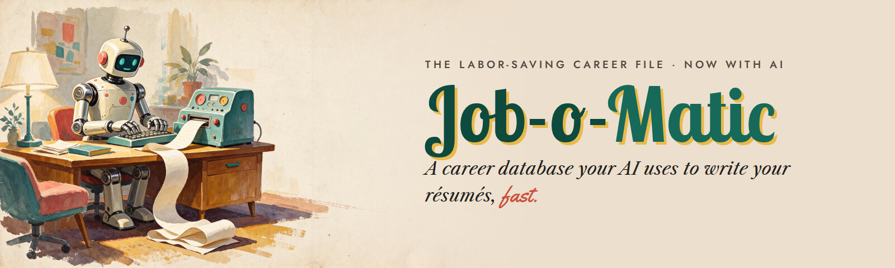

# Job-o-Matic

*The labor-saving career file. Now with AI.*

Job-o-Matic is a local career database. It is one SQLite file on the person's computer. Their AI reads it to write resumes, cover letters and interview answers, and writes new facts back as it learns them. The person seeds it once, then reviews what the AI saved. No account, no server, MIT licence.

**If you are an AI, start at [[Quick-Start-for-AI]].**

## Page map

### For AI agents
- [[Quick-Start-for-AI]]: three ways in, fastest path to a resume, must-follow rules
- [[Data-Model]]: diagram of the tables and how facts become resume lines
- [[Rules-and-Invariants]]: every rule the database enforces
- [[Filling-From-Documents]]: turn the person's old documents into facts
- [[Making-a-Resume]]: `resume_data`, `build_resume`, templates, versions
- [[Interview-QA]]: the `qa` table and `qa_open`

### Reference
- [[Table-Reference]]: every table and column
- [[MCP-Tools]]: every MCP tool
- [[Command-Line]]: `src/db.py` options

### For people
- [[Install-and-First-Run]]: download, open, connect your AI
- [[Your-Data-and-Privacy]]: where your data lives and who can see it
