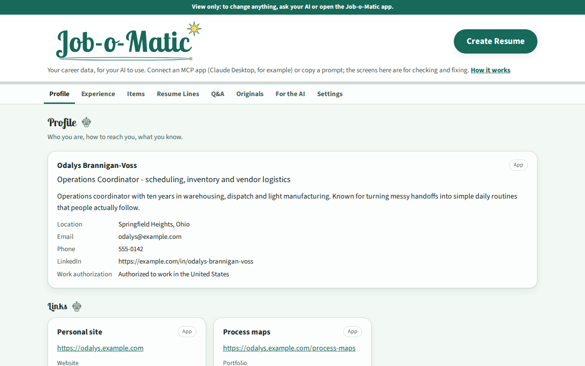

# Install and First Run


Job-o-Matic is free (MIT). It runs on your computer. Python comes inside the download, so there is nothing else to install.



## 1. Download
Open the newest release on the project's Releases page and pick the file for your computer:

| Computer | File |
|---|---|
| Windows | `Job-o-Matic_v<version>_windows-x64.zip` |
| Mac, Apple chip | `Job-o-Matic_v<version>_macos-arm64.zip` |
| Mac, Intel | `Job-o-Matic_v<version>_macos-x64.zip` |
| Linux | `Job-o-Matic_v<version>_linux-x64.zip` |

Which Mac do I have? Apple menu, then **About This Mac**. "Apple M1" (or M2, M3 ...) means Apple chip. "Intel" means Intel.

## 2. Unzip and open
Unzip anywhere, for example in Documents. The app is free and not paid-for "signed", so your computer warns you once. This is expected. Nothing is sent anywhere.

**Windows.** Right-click the zip and choose **Extract All** (a zip opened without extracting can fail). Double-click `Job-o-Matic.bat`. If a blue box says "Windows protected your PC", click **More info**, then **Run anyway**. A black window stays open while the app runs. Closing it stops the app.

**Mac.** Double-click `Job-o-Matic.command`. A box says it can't be opened. Click **Done**. Open **System Settings**, then **Privacy & Security**, scroll to the Security heading and click **Open Anyway** next to the Job-o-Matic message. Confirm with **Open** and your Mac password. (On macOS 14 and older you can right-click the file and choose **Open**.) You may see the same box once more for the bundled Python. Do the same again. A Terminal window stays open while the app runs. Closing it stops the app.

**Linux.** In a terminal run `chmod +x job-o-matic.sh` once, then `./job-o-matic.sh`.

## 3. The local address
A browser tab opens at `http://127.0.0.1:8765/app/`. If 8765 is busy, the next free number is shown in the window that stays open. `127.0.0.1` is your own computer. Nothing goes on the internet. The program stops by itself after 20 minutes without use.

## 4. Just look around
Double-click `Job-o-Matic (view only).html`. It needs no program running.

## 5. Connect your AI
- **Quickest: from PyPI** (needs [uv](https://docs.astral.sh/uv/)). Add this to your MCP app's config; it creates your database on first run. `uvx --from job-o-matic job-o-matic` opens the screens.
  ```json
{ "mcpServers": { "job-o-matic": { "command": "uvx", "args": ["job-o-matic-mcp"] } } }
  ```
- **Best: any MCP app** (Claude Desktop, for example). Run the connector once, then fully quit the app and reopen it. Add `--write` to install; leave it off to preview.
  - Windows: `python\python.exe app\scripts\connect_claude_desktop.py --write`
  - Mac / Linux: `python/bin/python3 app/scripts/connect_claude_desktop.py --write`

  The connector is written for Claude Desktop. For other MCP apps, point the app at `app/src/jobomatic/mcp_server.py` with the bundled Python.
- **An AI that runs commands:** point it at `app/docs/AI_GUIDE.md`.
- **Any chat AI:** click the robot button on a section, or **Create Resume**, copy the prompt, paste it into your AI, paste its answer back.

Then ask, for example: "Read my old resume in Job-o-Matic's originals and fill in my experience."

AI agents: see [[Quick-Start-for-AI]]. Your data: [[Your-Data-and-Privacy]].
