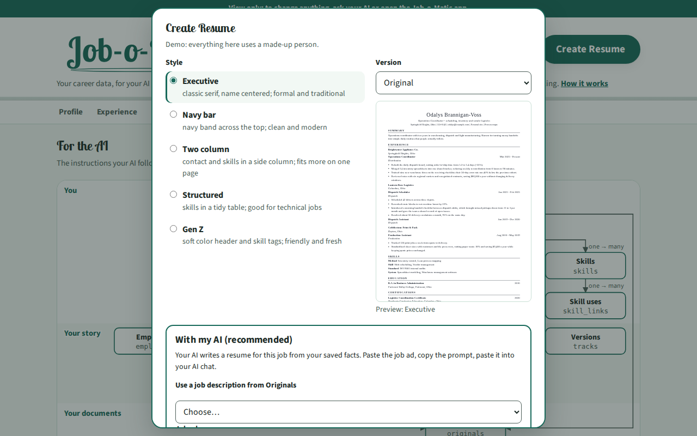

# Making a Resume



Two routes. Pick by what the person wants.

| Route | Tool | You get |
|---|---|---|
| You write the resume | `resume_data(track)` | One JSON document. Write the text yourself in any format. |
| The app fills a template | `build_resume(template, track)` | An HTML file in `my_data/resumes/`. The person prints it to PDF. |

## `resume_data(track="Original")`
Returns the whole resume for one version. SQL equivalent: `SELECT resume FROM resume_json WHERE track='Original'`. Unknown track raises an error listing the valid names.

Shape:
- `track`
- `person`: `name`, `full_name`, `first_name`, `last_name`, `headline`, `location`, `email`, `phone`, `work_auth_status`, `work_auth_country`, `work_authorization`, `summary` (LinkedIn is in `links`)
- `links`: Active links (`kind`, `label`, `url`)
- `employers[]`: each with `positions[]`; each position has `title`, `department`, `start_date`, `end_date`, and:
  - `lines[]`: ranked resume lines (`wording`, `length`, `angle`, `status`) with the `item` behind each (`kind`, `title`, `detail`, `metrics[]`)
  - `items_without_lines[]`: items at this position with no printable line in this track. Write lines for them if they matter.
- `skills`: only `Verified` skills
- `education`: every non-Deprecated row, newest year first
- `items`: every item kind except `Responsibility` and `Achievement` (awards, projects, publications, volunteer, speaking, reviews, kudos ...), with metrics
- `warnings`: strings such as `3 printed rows are Needs review ...` and `2 skills are hidden because not Verified.` Tell the person.

Ranking inside a position: `Verified` lines first, then `Short`, then `Long`, then by `id`. `Story` lines are never in `lines`. They are for cover letters and interviews: read them with `list('bullet_variants')` or `SELECT * FROM resume_lines WHERE length='Story'`. `Deprecated` lines and lines of `Deprecated` items are left out. A line with `length` NULL is treated like `Long` for ranking and is printed.

To tailor to a job, call `search` with the job description first. Use the matching `source_id`s to decide which lines to keep and which to reword.

## `build_resume(template, track="Original")`
Templates (exact names, from `src/jobomatic/resume.py`):

| `template` | Known differences |
|---|---|
| `executive` | Summary, Experience, Skills (grouped by category), Education ... |
| `navy_bar` | Skills come before Experience |
| `two_column` | Two-column layout; Awards and Projects follow Experience |
| `structured` | Skills grouped by category |
| `genz` | Skills printed as tags, not grouped |

All five fill the same data. They differ in layout and section order. Open the HTML to see the look.

An unknown name raises `Unknown template ...; use one of executive, navy_bar, two_column, structured, genz`.

Output: `my_data/resumes/<YYYY-MM-DD>_<template>_<track>_<HHMMSS>.html`. An earlier file is never overwritten. Returns `{"path": ..., "warnings": [...]}`.

What prints: summary, Experience (employers with positions and their lines), Skills, Education, Certifications (education rows of kind `Certification`), Awards (`items.kind='Award'`) and Projects (`items.kind='Project'`). Empty sections are left out. Only `Short` and `Long` lines print. If you want a different layout, use `resume_data` and write it yourself.

## Versions (tracks) and lengths
- A **version** is a row in `tracks` (`Original` exists on every install; the demo adds `Leadership`). A resume line belongs to one version through `bullet_variants.track`.
- A version prints only its own lines. There is no fallback to `Original`. To make a "Leadership" resume, write lines with `track='Leadership'` for the items that matter.
- Add a version first, then its lines:
```sql
INSERT INTO tracks (name, updated_by) VALUES ('Leadership', 'ai');
INSERT INTO bullet_variants (item_id, wording, length, track, updated_by)
VALUES (12, 'Led a six-person dispatch team through a system change.', 'Short', 'Leadership', 'ai');
```
- **Length:** `bullet_variants.length` is `Short`, `Long` or `Story`. `Short` and `Long` print. `Story` is a paragraph for letters and interviews and is not printed. If an item has both a `Short` and a `Long` line in a version, both print, `Short` first. To keep a resume to one page, retire (`status='Deprecated'`) the lines you do not want. The app does not trim for you.
- Renaming a version renames it on all its lines (`tracks_rename`). Retire a version with `status='Retired'`.

## Print to PDF
The person opens the HTML file in a browser and uses the browser's Print, then Save as PDF. In the app, **Create Resume** does the same from a dialog. If you have no tools, the dialog gives a prompt to paste into your chat; paste the finished text back.

## Checklist before you hand it over
1. `warnings` empty, or told to the person.
2. Every number on the page comes from `item_metrics`.
3. Wording stays close to the stored facts ([[Rules-and-Invariants]]).

Related: [[Data-Model]], [[MCP-Tools]], [[Quick-Start-for-AI]].
