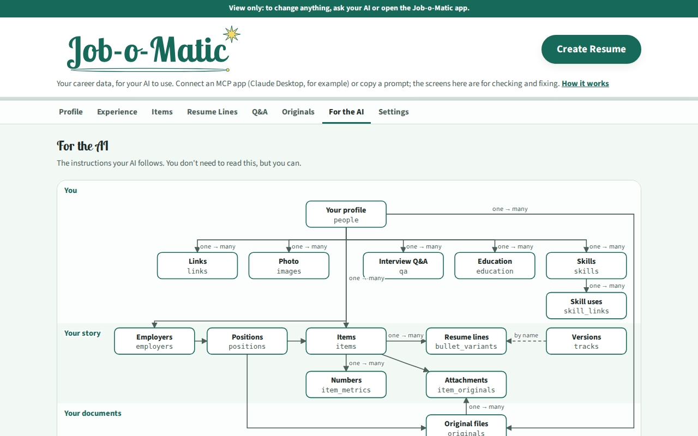

# Your Data and Privacy

**Job-o-Matic keeps everything on your computer.** It has no account, no server and no analytics, and it never sends your data anywhere.

## Where things are
Everything is in the `my_data` folder next to the app.
- `my_data/jobomatic.db`: your profile, history and answers, in one file.
- `my_data/originals/`: documents you add, copied unchanged, with their text saved beside them.
- `my_data/resumes/`: resumes your AI builds (HTML; print to PDF).
- `my_data/backups/`: a checked copy of the database is saved each day it changes. The newest 30 are kept.

To back up everything, copy the whole `my_data` folder.

## The local program
The editing screen runs a small program that only accepts connections from your own computer (`127.0.0.1`). It stops by itself after 20 minutes without use.

## Who changed what
Every change is marked as made by **You** or your **AI**. The record cannot be edited or deleted. Rows are never deleted. They are retired and hidden instead. Rows your AI adds start as "Needs review" until you confirm them.

## Your AI is a separate service
When you connect an AI (for example Claude Desktop, through the included MCP server), that AI reads and writes your Job-o-Matic data. What it reads may be sent to its provider under the provider's own privacy terms. Job-o-Matic does not control that. Connect only an AI you trust with this information.

## Copy and paste goes to that website
If you copy a prompt from Job-o-Matic and paste it into a chat website, everything in that prompt is sent to that website's company. Job-o-Matic cannot see or stop that.

## Remove everything
Delete the `Job-o-Matic` folder. If you added Job-o-Matic to your AI app's settings, remove the `job-o-matic` entry there too.

Related: [[Install-and-First-Run]].
